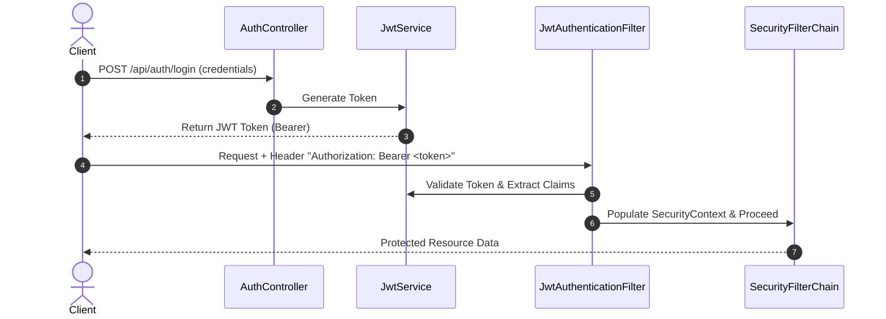

# Spring Security Internal Architecture

A comprehensive Spring Boot 3 & Spring Security 6 project demonstrating internal architecture, custom security filters, authentication mechanisms, and JSON Web Token (JWT) integration.

---

## 📌 Features & Architecture Overview

This project explores various configurations and customizations within Spring Security's filter chain and authentication manager:

1. **JWT (JSON Web Token) Authentication**
   - Stateless session management using JJWT (`jjwt-api`, `jjwt-impl`, `jjwt-jackson` v0.12.6).
   - Custom `JwtAuthenticationFilter` verifying Bearer tokens on incoming HTTP requests.
   - `JwtService` handling token generation, validation, and claim extractions.

2. **Custom Security Filters**
   - `FilterWithTimer`: Custom filter measuring request execution time.
   - `LimitLoginAttempts`: Custom filter tracking and restricting excessive failed login attempts.

3. **Multiple Security Configurations & Strategies**
   - `Access`: Main Security Filter Chain configuration (`SecurityFilterChain`).
   - `CustomerUserInMemory`: In-memory user authentication setup.
   - `CustomDatabaseAccess` & `DefaultJbdcwithdatabaseConfig`: Database-backed user authentication setup via Spring Data JPA & H2.

4. **Web & REST API**
   - `AuthController`: Handles authentication requests and token issuing.
   - `ControllerGate`: Web endpoints demonstrating secured vs. public access.
   - Integrated Thymeleaf view support with `thymeleaf-extras-springsecurity6`.

---

## 🛠 Tech Stack

- **Java Version:** 17
- **Framework:** Spring Boot 3.4.0
- **Security:** Spring Security 6, JJWT 0.12.6
- **Database & ORM:** H2 Database (In-Memory), Spring Data JPA
- **Templating:** Thymeleaf
- **Utilities:** Lombok, ModelMapper 3.2.2
- **Build Tool:** Maven

---

## 🚀 Getting Started

### Prerequisites
- JDK 17 or higher installed
- Maven 3.8+ (or use the included `mvnw` wrapper)

### Installation & Execution

1. **Clone the repository:**
   ```bash
   git clone <repository-url>
   cd springsecurityinternalarchitecture
   ```

2. **Build the project:**
   ```bash
   ./mvnw clean package
   ```

3. **Run the application:**
   ```bash
   ./mvnw spring-boot:run
   ```
   The application will start on `http://localhost:8080`.

---

## 🔑 Authentication Flow



---

## 📁 Project Structure

```
src/main/java/ma/xproce/springsecurityinternalarchitecture/
├── dao/
│   ├── entities/       # JPA Entities (Customer, etc.)
│   └── repositories/   # Spring Data Repositories
├── dto/                # Data Transfer Objects (LoginRequest, AuthCustomer, etc.)
├── mapper/             # Entity-DTO Mappers (UserMapper)
├── security/
│   ├── config/         # SecurityFilterChain & Access Configurations
│   ├── filters/        # Custom Security Filters (FilterWithTimer, LimitLoginAttempts)
│   ├── jwt/            # JwtAuthenticationFilter & JwtService
│   └── user/           # Custom UserDetails / UserDetailsService implementations
└── web/                # REST Controllers (AuthController, ControllerGate)
```

